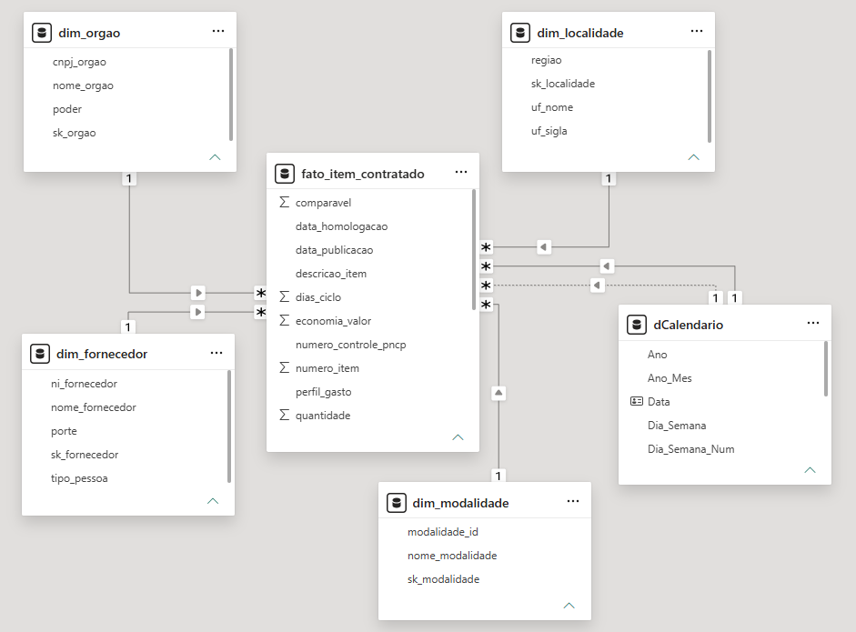
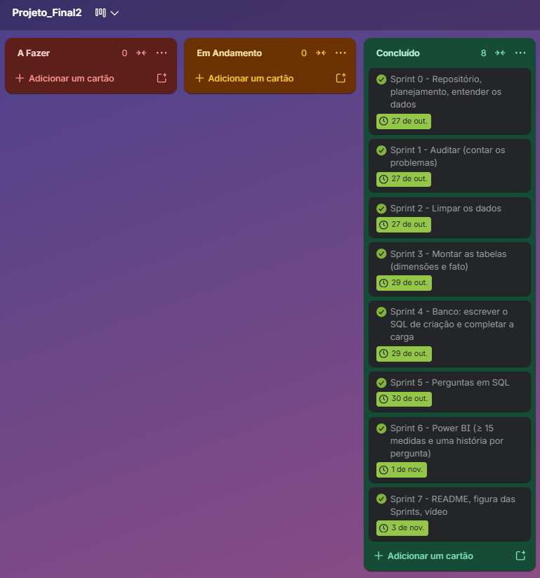

# PNCP Controladoria — Análise de Compras Públicas - Lucas Nunes da Rosa T2

## 1. Contexto do problema

As compras e contratações públicas movimentam grandes volumes de recursos e exigem acompanhamento constante para garantir transparência, eficiência e economia na utilização do dinheiro público.

Nesse contexto, a Controladoria precisa identificar possíveis sobrepreços, concentração de contratações em determinados fornecedores, demora nos processos de compra e diferenças nos resultados entre modalidades e regiões.

Este projeto tem como objetivo analisar os dados de Contratações Públicas do Portal Nacional de Contratações Públicas (PNCP),transformando arquivos brutos em informações organizadas e indicadores que auxiliem a Controladoria na fiscalização e na tomada de decisões.

Por meio de um pipeline desenvolvido com Python, MySQL e Power BI, os dados são auditados, tratados, armazenados em um modelo dimensional e apresentados em um dashboard interativo.

## 2. Tecnologias utilizadas

- **Python:** limpeza e transformação dos dados.
- **Pandas:** manipulação e análise dos arquivos CSV.
- **MySQL:** armazenamento dos dados em um banco dimensional.
- **SQL:** consultas para responder às perguntas de negócio.
- **Power BI:** criação do dashboard e visualização dos resultados.
- **Git e GitHub:** controle de versões e armazenamento do projeto.

## 3. Tratamento dos dados

Os arquivos originais utilizados foram:

- `compras.csv`
- `itens.csv`
- `resultados.csv`

O tratamento foi realizado em Python, com o objetivo de corrigir inconsistências, padronizar informações e preparar os dados para a criação das tabelas do banco.

Entre os tratamentos realizados estão:

- Padronização de datas e valores monetários.
- Limpeza e validação de CNPJs e CPFs.
- Correção de caracteres acentuados.
- Tratamento de valores vazios e marcadores de ausência.
- Padronização de nomes de órgãos e fornecedores.
- Seleção de um único vencedor por item.
- Cálculo dos valores totais estimados e homologados.
- Identificação de itens comparáveis para o cálculo da economia.

### Regras de negócio

1. Considerar apenas itens com resultado homologado.
2. Selecionar um único vencedor por item.
3. No Registro de Preços, desconsiderar resultados cancelados e selecionar a menor ordem de classificação. Em caso de empate, utilizar o menor número sequencial.
4. Descartar itens com quantidade inválida ou valores ausentes e menores ou iguais a zero.
5. Descartar itens sigilosos e registros que ultrapassem os limites definidos no projeto.
6. Calcular os valores totais utilizando o valor unitário e a quantidade homologada. Quando a quantidade homologada estiver vazia ou zerada, utilizar a quantidade do item.
7. Calcular a economia somente para itens comparáveis.
8. Não considerar ciclos com datas inválidas ou homologação anterior à publicação no cálculo do tempo de contratação.

## 4. Decisões técnicas

Durante o desenvolvimento do projeto, foram adotadas decisões técnicas para garantir a organização, a qualidade e a confiabilidade dos dados, além de facilitar sua análise e visualização.

- **Python e Pandas:** utilizados para realizar a auditoria, limpeza e transformação dos arquivos CSV. Essa escolha permitiu automatizar o tratamento dos dados e padronizar informações antes de carregá-las no banco de dados.

- **Padronização dos dados:** foram tratados formatos inconsistentes de datas, valores monetários, CNPJs e caracteres especiais. Também foram avaliados valores ausentes e possíveis inconsistências temporais, preservando valores que poderiam ser válidos dependendo do contexto da coluna.

- **MySQL:** escolhido para armazenar os dados tratados e estruturar as informações em tabelas relacionadas, facilitando consultas e análises por meio de SQL.

- **Modelo dimensional Star Schema:** adotado para organizar os dados em uma tabela fato central (`fato_item_contratado`) e tabelas dimensão, como órgão, localidade, fornecedor, modalidade e calendário. Essa estrutura facilita o cruzamento de informações e melhora a organização das análises.

- **Power BI:** utilizado para desenvolver o dashboard interativo, com indicadores, gráficos, filtros, navegação por páginas e tooltips personalizados, permitindo explorar os dados de forma visual e intuitiva.

- **Variáveis de ambiente:** utilizadas para armazenar configurações sensíveis de conexão ao banco de dados fora do código-fonte. O arquivo `.env.example` foi disponibilizado como modelo de configuração, sem expor credenciais.

Essas decisões permitiram construir um fluxo organizado, desde os dados brutos do PNCP até a apresentação dos indicadores no dashboard.

## 5. Modelagem do banco de dados

O banco utilizado é o `pncp_controladoria`, desenvolvido no MySQL.

A modelagem segue o formato **Star Schema**, composto por uma tabela fato e quatro tabelas dimensão.

### Diagrama do modelo dimensional




## 6. Perguntas de negócio

Resultados e análises do dashboard

O dashboard foi organizado em seis páginas principais, cada uma dedicada a uma pergunta de negócio.

1. #Qual foi o valor total economizado pelo governo e qual o percentual de economia?

A análise identificou uma economia nominal de aproximadamente R$ 992,86 milhões, equivalente a 14,46% do valor estimado comparável de aproximadamente R$ 6,87 bilhões.

Esse resultado indica que o valor homologado ficou abaixo do valor inicialmente estimado nos itens comparáveis.

2. #Quais são os maiores fornecedores e qual percentual dos recursos está concentrado neles?

Os dez maiores fornecedores concentram aproximadamente 41,43% do volume financeiro homologado.

Esse cenário demonstra uma concentração relevante das contratações e merece acompanhamento quanto à competitividade e à dependência de fornecedores.

3. #Quais modalidades apresentam maior economia e quais concentram os maiores volumes de recursos?

A análise permite comparar o volume financeiro e os percentuais de economia das modalidades de contratação.

O Pregão Eletrônico apresentou deságio de 9,56 pontos percentuais acima da média geral, indicando resultado superior nesse indicador.

4. #Qual é o tempo médio entre a publicação do edital e a homologação, por órgão?

A análise compara a duração dos processos entre a publicação do edital e a homologação.

O maior ciclo identificado foi de 611 dias, permitindo observar diferenças entre órgãos e identificar possíveis oportunidades de melhoria nos prazos.

5. #Quais estados e regiões concentram as maiores despesas e quais apresentam os melhores indicadores de desconto?

A análise regional apresenta a distribuição dos volumes homologados e dos percentuais de economia por estado, complementada pela quantidade de unidades compradoras.

Essas informações permitem comparar a distribuição dos gastos e identificar concentrações regionais.

6. #Como os recursos estão distribuídos entre Bens, Serviços e Obras e Engenharia?

A análise apresenta a distribuição dos recursos entre bens, serviços e obras e engenharia, comparando volume homologado, economia percentual, participação e ticket médio.

Essa visão auxilia na compreensão da composição das despesas públicas.

As consultas SQL utilizadas estão no arquivo `sql/02_perguntas.sql`.

## 7. Auditoria da Qualidade dos Dados

### 7.1. Quantidade de registros

| Arquivo | Quantidade de linhas |
|---|---:|
| `compras.csv` | 2.042 |
| `itens.csv` | 7.077 |
| `resultados.csv` | 15.896 |

Não foram encontradas duplicidades na coluna `numero_controle_pncp` do arquivo `compras.csv`. Os 2.042 registros possuem valores distintos nessa coluna.

### 7.2. Formatos de dados e valores inconsistentes

Durante a auditoria, foram identificadas diferentes representações de valores monetários, datas e CNPJs.

- **Valores monetários:** formatos com ponto ou vírgula como separadores decimais e de milhar, além de valores com o prefixo `R$`.
- **Datas:** formatos ISO (`2025-01-06T11:51:06`), com barras (`02/01/2025`), pontos (`02.01.2025`), hífens e números sem separadores (`20250102`).
- **CNPJs:** valores sem pontuação (`00889834000108`) e formatados (`51.593.855/0001-04`), exigindo padronização e validação.

Também foram encontrados marcadores como `N/A`, `-`, `0` e células vazias nas seguintes colunas:

| Arquivo | Coluna | Valores identificados |
|---|---|---|
| `compras.csv` | `processo` | `N/A`, `-`, `0` |
| `compras.csv` | `modo_disputa` | `N/A`, `-`, `0` |
| `compras.csv` | `data_abertura_proposta` | Células vazias |
| `compras.csv` | `data_encerramento_proposta` | Células vazias |
| `itens.csv` | `situacao_item` | `N/A`, `-`, `0` |
| `itens.csv` | `unidade_medida` | Células vazias |
| `itens.csv` | `catalogo_codigo_item` | Células vazias |
| `resultados.csv` | `porte` | `N/A`, `-`, `0` |
| `resultados.csv` | `ordem_classificacao_srp` | Células vazias |
| `resultados.csv` | `data_cancelamento` | Células vazias |

Os valores foram avaliados considerando o conteúdo exato das células. O valor `0` não foi considerado automaticamente um erro, pois pode representar uma informação válida dependendo da coluna.

### 7.3. Problemas de codificação de caracteres

Foram identificados textos com caracteres acentuados corrompidos, possivelmente associados a problemas de codificação dos arquivos.

| Arquivo | Coluna | Exemplos |
|---|---|---|
| `compras.csv` | `objeto_compra` | `Contratação` |
| `compras.csv` | `municipio` | `São Carlos` |
| `compras.csv` | `nome_unidade` | Textos com indícios de codificação incorreta |
| `itens.csv` | `descricao` | `Estação Trabalho` |
| `resultados.csv` | `nome_fornecedor` | `Aéronav Inc.` |

Esses casos evidenciam a necessidade de corrigir a codificação dos caracteres durante o processo de limpeza, preservando os acentos e a grafia original dos textos.

### 7.4. Inconsistências nas datas

Na comparação entre `data_resultado`, do arquivo `resultados.csv`, e `data_publicacao`, do arquivo `compras.csv`, utilizando `numero_controle_pncp` para relacionar os registros, foram identificadas datas de resultado anteriores às datas de publicação.

Foram encontrados **1.056 registros** com essa condição, associados a **506 compras distintas**.

Essas ocorrências foram consideradas possíveis inconsistências temporais e devem ser verificadas durante a limpeza e validação dos dados, levando em conta os diferentes formatos de data presentes nos arquivos.

## 8. Power BI

O Power BI é utilizado para apresentar os resultados das análises por meio de um dashboard interativo.

O painel deve contemplar:

- Pelo menos 15 medidas DAX.
- Tabela calendário criada com DAX.
- Organização e ordenação correta das informações temporais.
- Menu interativo com botões e bookmarks.
- Tooltip personalizado.
- Aplicação dos princípios de contraste, repetição, alinhamento e proximidade (CRAP).

## 9. Como executar o projeto

Para reproduzir o projeto do início, siga as etapas:

1. Baixe ou clone o repositório.
2. Coloque os arquivos originais `compras.csv`, `itens.csv` e `resultados.csv` na pasta `data/raw/`.
3. Configure os dados de conexão com o MySQL no arquivo `src/config.py`.
4. Execute os scripts de limpeza e transformação dos dados.
5. Execute o script de criação do banco e das tabelas.
6. Execute o carregamento dos dados no MySQL.
7. Utilize as consultas disponíveis em `sql/02_perguntas.sql`.
8. Abra o arquivo do dashboard no Power BI.

### Executar o pipeline

Execute as etapas na seguinte ordem:

**1. Auditoria e limpeza dos dados**

```bash
python -m src.limpeza
```

**2. Montagem das tabelas**

```bash
python -m src.montar_tabelas
```

**3. Criação do banco de dados**

Execute o script abaixo no MySQL Workbench:

```text
sql/01_criar_banco.sql
```

**4. Carga dos dados**

```bash
python -m src.carregar
```

**5. Consultas analíticas**

Execute as consultas do arquivo no MySQL Workbench:

```text
sql/02_perguntas.sql
```

## 10. Planejamento das Sprints

### Imagem do planejamento das Sprints




## 11. Melhorias futuras

- Ampliar o período de análise para outros anos.
- Automatizar a atualização dos dados.
- Adicionar novas análises sobre as compras públicas.
- Melhorar a apresentação e a navegação do dashboard.

## 12. Conclusão

O projeto permitiu aplicar na prática conhecimentos de Python, MySQL, SQL e Power BI, transformando dados brutos do PNCP em informações organizadas e indicadores interativos. As análises realizadas ajudam a compreender os gastos públicos, identificar oportunidades de economia e apoiar a fiscalização e a tomada de decisões.